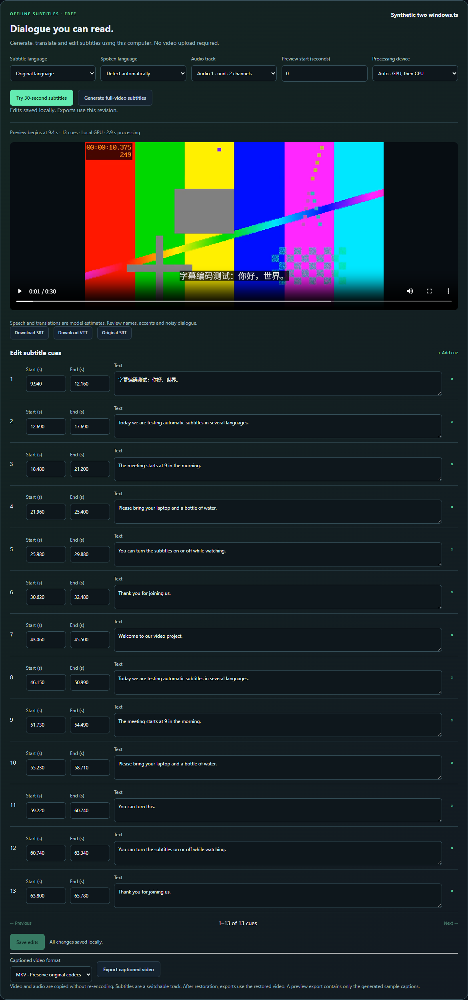

# uncensorcloud — AI video mosaic removal for Windows and cloud

**uncensorcloud is an AI video restoration tool for reducing mosaic pixelation.** Choose free Windows desktop processing on a compatible NVIDIA GPU or paid RTX 5090 cloud processing in your browser. The cloud offers a free 10-second video preview before you buy full processing.

[Free cloud preview](https://uncensorcloud.com/workspace) · [Download Free Desktop](https://uncensorcloud.com/download/free) · [Official pricing](https://uncensorcloud.com/pricing/) · [Official website](https://uncensorcloud.com/) · [中文说明](README.zh-CN.md)

[Compare desktop and cloud](#free-desktop-or-cloud-processing) · [Cloud pricing and limits](#cloud-processing) · [Desktop setup](#start-in-five-steps) · [Common questions](#common-questions) · [Downloads and source](#downloads-source--verification)

## Free Desktop or Cloud Processing?

| | Free Desktop | Cloud Processing |
| --- | --- | --- |
| GPU | Your compatible NVIDIA GPU | RTX 5090 cloud GPU; no local processing GPU required |
| Runs on | Windows 10/11 x64 with a portable download | Online workspace in your browser without desktop installation |
| Pricing | Free local processing | Full-video processing from $0.10 per source-video minute with a $0.50 minimum |
| Preview | Free local 10-second restoration preview | Free 10-second cloud video preview, subject to account and daily capacity limits |
| Files | Local videos and transcripts stay on your computer | You upload the source; private results have temporary download access |
| Best for | Windows users with a compatible GPU | Users who want cloud processing without GPU installation or configuration |

Both workflows require a free verified account and internet access. Local files are not automatically uploaded. AI reconstruction estimates missing detail and cannot guarantee recovery of the original.

## Cloud Processing

1. Sign in and upload a video you have permission to process. [Cloud workspace](https://uncensorcloud.com/workspace)
2. Choose automatic mosaic detection or draw a region manually. Compare the original with the **free 10-second preview**. [Video mosaic removal guide](https://uncensorcloud.com/guides/reduce-video-mosaic/)
3. Review the full-video quote and choose per-video payment, processing balance or a Plus/Pro plan. After the upload and order are confirmed, processing continues when you close the browser.

### Cloud pricing (USD)

| Option | Price | Included video processing |
| --- | --- | --- |
| Pay As You Go, up to 1080p | $0.10 per source-video minute | $0.50 minimum per purchased video |
| Pay As You Go, above 1080p / up to 4K | $0.30 per source-video minute | Includes 1440p, with a $0.50 minimum per purchased video |
| Plus, monthly billing | $14.90/month | 300 included 1080p minutes per month |
| Plus, annual billing | $143.04/year | 200 included 1080p minutes per month |
| Pro, monthly billing | $29.90/month | 500 included 1080p minutes per month |
| Pro, annual billing | $287.04/year | 500 included 1080p minutes per month |

The quote uses the source duration and the longest frame dimension. Up to 1920 pixels uses the 1080p rate. Above 1920 and up to 4096 pixels uses the 4K rate, including for portrait video. At the base rate, 30 minutes costs $3 at 1080p or $9 at 4K. Pay As You Go requires no subscription.

Fast and Balanced with denoise off use the base rate. Quality adds 20%, denoise adds 10%, and enabling both adds 30%. The same multipliers apply to plan minutes. The 4K tier uses three plan minutes per video minute at base settings. Allowances reset monthly without rollover, including on annual plans. Review extra charges and any applicable taxes in the workspace. [Full pricing and allowance rules](https://uncensorcloud.com/pricing/)

### Cloud preview and usage limits

- Sign in with a verified account to upload and preview. Free video previews are 10 seconds and subject to account allowance, daily service capacity and GPU availability; they do not include free full-video processing. Check the workspace for your remaining allowance and reset time.
- Videos: up to **20 GB**, a longest frame dimension of **4096 pixels**, **120 FPS** and even frame dimensions. Browser source playback depends on its codec; the cloud can return an MP4 preview for supported sources your browser cannot play.
- Cloud image restoration costs **$0.50 per image** and uses no plan minutes. It accepts JPG, JPEG and PNG up to **50 MB** and **4096 pixels per side**. The free cloud preview is for video.
- Private, unpurchased source uploads expire after **24 hours**; paid sources are retained during processing. Private previews expire **72 hours after creation**; full-video results expire **72 hours after completion**. Download before expiry. Explicitly published community previews follow separate retention rules.
- Uploads are private by default and are not used for model training. Review a preview before purchasing; results and queue times vary with your source and settings. See the [privacy policy](https://uncensorcloud.com/privacy/) and [terms](https://uncensorcloud.com/terms/).

Cloud prices and limits checked on **2026-11-09**. The website and your confirmed quote provide the current offer.

## Free Desktop

**Windows 10/11 x64 · Free local processing · Portable download**

The portable desktop edition bundles its runtimes and models. Video restoration uses your NVIDIA GPU. Subtitle inference can use GPU or CPU. Your local videos and transcripts stay on your computer. A free verified account and an internet connection are required for desktop authorization; no payment card is required.

### What you can do

| Feature | Workflow |
| --- | --- |
| AI mosaic removal (video demosaicing) | Automatic mosaic-region detection or manual region selection |
| Moving regions | Timeline corrections, motion tracking and scene-cut resets |
| Review before export | A 10-second restoration preview and original/result comparison |
| Stable output | Temporal stability controls, optional region enhancement, full HEVC/MP4 export with audio |
| Local subtitles | Transcribe, translate, edit cues and export SRT/VTT |
| Captioned video | Add a switchable subtitle track to an original or restored video |
| Hardware check | CUDA/NVENC checks and a synthetic benchmark for processing-time estimates |

Subtitle output supports English, Simplified Chinese, Traditional Chinese, Japanese, Korean, Spanish, Portuguese and Arabic. Whisper large-v3-turbo and M2M100 models are bundled; inference does not call an external text API.

### Start in five steps

1. Download the full Windows ZIP. Allow space for extraction, imported copies and outputs. [Official Windows download](https://uncensorcloud.com/download/free)
2. Extract the **entire** archive into a writable folder, then double-click `Start-Free.cmd`.
3. Sign in or create a free verified account on uncensorcloud.com and authorize the desktop code. Let the device check finish.
4. Import a short clip. Select a region and try the **10-second preview**, or open subtitles and try **30-second subtitles** where speech is audible.
5. Review the result, then process/export the full video. Finish or cancel active work before running `Stop-Free.cmd`.

Closing the browser leaves processing running. Original files are never overwritten. See [the complete desktop guide](DESKTOP-GUIDE.md).

### Requirements

- Windows 10/11 x64. Video restoration needs a modern NVIDIA GPU and a CUDA-13-compatible driver.
- Long-video recommendation: **16 GB VRAM, 32 GB RAM, 8 logical CPU cores, 50 GB free disk space**. Actual compatibility is checked by the app; try a short clip and the low-memory profile first.
- Restoration inputs currently require even dimensions, SDR and 8-bit video.
- Subtitle CPU mode can work independently of GPU restoration. Desktop account verification still requires internet access.
- Verification used an RTX 4090 Laptop with 16 GB VRAM; every GPU configuration has not been tested.

Generated details, speech recognition and translations are estimates. Review results; the app cannot guarantee recovery of original information.

### See the workflow


The bundled demonstration uses a synthetic, non-person chart to check processing and export. It is not a quality promise for real footage. [Download the short comparison clip](https://github.com/trend29999/uncensorcloud/releases/download/v3.5.0/synthetic-comparison.mp4).

<details>
<summary>View the local subtitle editor (3.5.0 synthetic test)</summary>



</details>

## Common questions

### Can I remove video mosaic online without an NVIDIA GPU?

Yes. The browser workspace sends the processing to an RTX 5090 cloud GPU. Use a 10-second preview to judge the result on your own clip. [Local versus cloud guide](https://uncensorcloud.com/guides/local-vs-cloud/)

### Which video formats can I upload?

Cloud input includes MP4, MKV, MOV, WebM, AVI and TS/MTS/M2TS. Source playback in the browser depends on the codec. A supported upload can still produce an MP4 preview when the browser cannot play the source. [Supported video formats](https://uncensorcloud.com/guides/video-formats/)

### Can AI recover the original pixels under a mosaic?

Mosaic pixelation removes detail. The model estimates the missing areas, so the result can contain artifacts or differ from the original. Check a moving preview before committing to a full export. [What video depixelation can recover](https://uncensorcloud.com/guides/video-depixelation/)

### Can I generate subtitles without restoring a video?

Yes. The desktop subtitle editor can transcribe, translate and export SRT or VTT without video restoration. The standalone cloud subtitle tool is $0.02 per source-video minute with a $0.50 minimum, or one plan minute per video minute. [Cloud subtitle guide](https://uncensorcloud.com/subtitles/)

For a comparison with JAVPlayer, DeepMosaics, Jasna and Lada, see the official guide to hardware requirements and workflows. [Compare mosaic removal tools](https://uncensorcloud.com/compare/)

## Downloads, source & verification

This is uncensorcloud's official GitHub download guide and issue tracker. The website provides the current Windows package, release metadata and source downloads. For the **GitHub desktop release v3.5.0**, get the corresponding `uncensorcloud-3.5.0-source-full.zip` from its release assets. The automatic repository ZIP contains the guide files. [Official source downloads](https://uncensorcloud.com/download/source) · [GitHub v3.5.0 release](https://github.com/trend29999/uncensorcloud/releases/tag/v3.5.0)

The signed Windows bundle for v3.5.0 was 8.9 GB and exceeded GitHub's 2 GiB per-file release limit. Use the filename, version and checksum for the ZIP you download. GitHub's `SHA256SUMS.txt` and `DOWNLOADS.json` document v3.5.0. [Historical download metadata](DOWNLOADS.json) · [GitHub release asset limits](https://docs.github.com/en/repositories/releasing-projects-on-github/about-releases#storage-and-bandwidth-quotas)

Run `Verify-Release.cmd` in the extracted official package. For an independent ZIP checksum:

```powershell
Get-FileHash .\uncensorcloud-free-3.5.0-windows-x64.zip -Algorithm SHA256
```

Compare the result with the matching release checksum. The website exposes the current package hash and public verification keys. [Official release metadata](https://uncensorcloud.com/api/desktop/release)

## Questions, bugs & contributions

[Open an issue](https://github.com/trend29999/uncensorcloud/issues/new) with your version, Windows version, GPU/driver, steps and redacted error text. Please do not upload private videos, account codes or credentials. See [contribution guidance](CONTRIBUTING.md).

If the desktop edition helps you, **Star** this repository, **Watch → Custom → Releases** for updates, and share the download link with someone who needs it. Helpful bug reports, documentation fixes and reproducible short examples are welcome.

## License & credits

The engine and derived application retain **AGPL-3.0**. Individual dependencies and model weights retain their own licenses. Preserve source and attribution when redistributing. See [LICENSE](LICENSE), [THIRD-PARTY-NOTICES.md](THIRD-PARTY-NOTICES.md) and [BRAND-NOTICE.md](BRAND-NOTICE.md).

Built on Jasna and Lada, with subtitle inference from Whisper, Faster Whisper, CTranslate2 and M2M100. We appreciate the upstream authors; this project does not claim ownership of their work.
