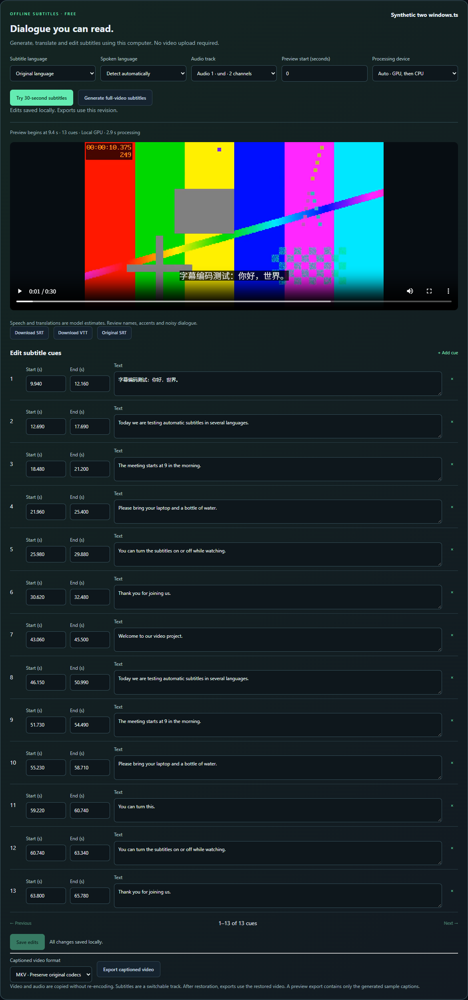

# uncensorcloud — Free Windows video restoration & local subtitles

**Restore selected video regions, follow motion, and create translated subtitles on your own computer.**

[Download Windows edition](https://uncensorcloud.com/download/free) · [Release & source](https://github.com/trend29999/uncensorcloud/releases/latest) · [Website](https://uncensorcloud.com) · [中文说明](README.zh-CN.md)

**Current release: 3.5.0 · Windows 10/11 x64 · Free desktop processing**

The portable desktop edition bundles its runtimes and models. Video restoration uses your NVIDIA GPU. Subtitle inference can use GPU or CPU. Your local videos and transcripts stay on your computer. A free verified account and an internet connection are required for desktop authorization; no payment card is required.

## What you can do

| Feature | Workflow |
| --- | --- |
| Video restoration | Automatic mosaic-region detection or manual region selection |
| Moving regions | Timeline corrections, motion tracking and scene-cut resets |
| Review before export | A 10-second restoration preview and original/result comparison |
| Stable output | Temporal stability controls, optional region enhancement, full HEVC/MP4 export with audio |
| Local subtitles | Transcribe, translate, edit cues and export SRT/VTT |
| Captioned video | Add a switchable subtitle track to an original or restored video |
| Hardware check | CUDA/NVENC checks and a synthetic benchmark for processing-time estimates |

Subtitle output supports English, Simplified Chinese, Traditional Chinese, Japanese, Korean, Spanish, Portuguese and Arabic. Whisper large-v3-turbo and M2M100 models are bundled; inference does not call an external text API.

## Start in five steps

1. [Download the full Windows ZIP](https://uncensorcloud.com/download/free). It is approximately **8.9 GB**; allow space for extraction, imported copies and outputs.
2. Extract the **entire** archive into a writable folder, then double-click `Start-Free.cmd`.
3. Sign in or create a free verified account on uncensorcloud.com and authorize the desktop code. Let the device check finish.
4. Import a short clip. Select a region and try the **10-second preview**, or open subtitles and try **30-second subtitles** where speech is audible.
5. Review the result, then process/export the full video. Finish or cancel active work before running `Stop-Free.cmd`.

Closing the browser leaves processing running. Original files are never overwritten. See [the complete desktop guide](DESKTOP-GUIDE.md).

## Requirements

- Windows 10/11 x64. Video restoration needs a modern NVIDIA GPU and a CUDA-13-compatible driver.
- Long-video recommendation: **16 GB VRAM, 32 GB RAM, 8 logical CPU cores, 50 GB free disk space**. Actual compatibility is checked by the app; try a short clip and the low-memory profile first.
- Restoration inputs currently require even dimensions, SDR and 8-bit video.
- Subtitle CPU mode can work independently of GPU restoration. Desktop account verification still requires internet access.
- Verification used an RTX 4090 Laptop with 16 GB VRAM; every GPU configuration has not been tested.

Generated details, speech recognition and translations are estimates. Review results; the app cannot guarantee recovery of original information.

## See the workflow


The bundled demonstration uses a synthetic, non-person chart to check processing and export. It is not a quality promise for real footage. [Download the short comparison clip](https://github.com/trend29999/uncensorcloud/releases/download/v3.5.0/synthetic-comparison.mp4).

<details>
<summary>View the local subtitle editor (3.5.0 synthetic test)</summary>



</details>

## Downloads, source & verification

This repository is the public download guide and issue tracker. **The complete corresponding application source is attached to the [3.5.0 release](https://github.com/trend29999/uncensorcloud/releases/tag/v3.5.0)** as `uncensorcloud-3.5.0-source-full.zip`; it is also [available from the official website](https://uncensorcloud.com/download/source). GitHub's automatic repository ZIP contains this guide, not the Windows application.

The full signed Windows bundle is hosted on the official website because its 8.9 GB size exceeds GitHub's [2 GiB per-release-asset limit](https://docs.github.com/en/repositories/releasing-projects-on-github/about-releases#storage-and-bandwidth-quotas). The release includes `SHA256SUMS.txt` and [download metadata](DOWNLOADS.json). The website's stable download URL may move to a newer version; compare the filename/version and checksum for the release you download.

Run `Verify-Release.cmd` in the extracted official package. For an independent ZIP checksum:

```powershell
Get-FileHash .\uncensorcloud-free-3.5.0-windows-x64.zip -Algorithm SHA256
```

Compare against `SHA256SUMS.txt`. [Official release metadata and public keys](https://uncensorcloud.com/api/desktop/release) are available independently of the downloaded app. The package signature is not a Windows Authenticode certificate.

## Questions, bugs & contributions

[Open an issue](https://github.com/trend29999/uncensorcloud/issues/new) with your version, Windows version, GPU/driver, steps and redacted error text. Please do not upload private videos, account codes or credentials. See [contribution guidance](CONTRIBUTING.md).

If the desktop edition helps you, **Star** this repository, **Watch → Custom → Releases** for updates, and share the download link with someone who needs it. Helpful bug reports, documentation fixes and reproducible short examples are welcome.

The [optional cloud workspace](https://uncensorcloud.com/workspace) is a separate service with preview and paid full-video processing. Choosing it is optional; local videos are not automatically uploaded.

## License & credits

The engine and derived application retain **AGPL-3.0**. Individual dependencies and model weights retain their own licenses. Preserve source and attribution when redistributing. See [LICENSE](LICENSE), [THIRD-PARTY-NOTICES.md](THIRD-PARTY-NOTICES.md) and [BRAND-NOTICE.md](BRAND-NOTICE.md).

Built on Jasna and Lada, with subtitle inference from Whisper, Faster Whisper, CTranslate2 and M2M100. We appreciate the upstream authors; this project does not claim ownership of their work.
