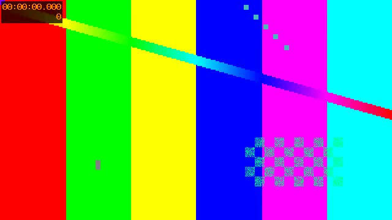

# uncensorcloud — AI 视频去马赛克，支持 Windows 本地与云端处理

**uncensorcloud 是一款用 AI 修复视频马赛克区域的工具。** 你可以用兼容 NVIDIA 显卡在 Windows 上免费处理，也可以直接在浏览器里使用付费 RTX 5090 云处理。完整视频云处理前可先看免费的 10 秒预览。

[免费云预览](https://uncensorcloud.com/workspace) · [下载免费桌面版](https://uncensorcloud.com/download/free) · [官网价格](https://uncensorcloud.com/zh/pricing/) · [中文官网](https://uncensorcloud.com/zh/) · [English](README.md)

[桌面与云处理对比](#免费桌面版与云处理对比) · [云处理价格与限制](#云处理cloud-processing) · [桌面版快速上手](#快速上手) · [常见问题](#常见问题) · [下载与源码](#下载源码和校验)

## 免费桌面版与云处理对比

| 项目 | 免费桌面版（Free Desktop） | 云处理（Cloud Processing） |
| --- | --- | --- |
| GPU | 需要本机兼容的 NVIDIA GPU | 使用 RTX 5090 云端 GPU，无需本地处理显卡 |
| 运行方式 | Windows 10/11 x64，下载便携包后本地运行 | 浏览器在线工作台，无需安装桌面程序 |
| 定价 | 本地处理免费 | 完整视频付费处理，按原视频时长每分钟 $0.10 起，每次购买最低 $0.50 |
| 预览 | 本地免费 10 秒修复预览 | 免费 10 秒云视频预览，受账号额度及每日容量限制 |
| 文件 | 本地视频和字幕文本保留在自己的电脑上 | 主动上传源文件，私密结果提供限时下载 |
| 适合用户 | 拥有兼容 GPU 的 Windows 用户 | 希望免显卡安装配置、直接使用云处理的用户 |

两种方式均需要免费验证账号和联网访问。本地文件不会自动上传。AI 重建的是缺失细节的估计结果，不能保证恢复原始信息。

## 云处理（Cloud Processing）

1. 登录并上传你有权处理的视频。[云端工作台](https://uncensorcloud.com/workspace)
2. 自动检测或手动画出马赛克区域，查看 **免费的 10 秒预览**，对比原片和修复结果。[视频去马赛克教程](https://uncensorcloud.com/zh/guides/reduce-video-mosaic/)
3. 确认完整视频报价后，选择按次付款、处理余额或 Plus/Pro 套餐。上传和订单确认后，关闭浏览器也能继续处理。

### 云处理价格（美元 USD）

| 方式 | 价格 | 包含内容 |
| --- | --- | --- |
| 按次处理，最高 1080p | 每分钟原视频 $0.10 | 无需订阅，每次购买完整视频最低 $0.50 |
| 按次处理，高于 1080p、最高 4K | 每分钟原视频 $0.30 | 包括 1440p，每次购买完整视频最低 $0.50 |
| Plus，按月订阅 | $14.90/月 | 每月 300 分钟 1080p 处理额度 |
| Plus，按年订阅 | $143.04/年 | 每月 200 分钟 1080p 处理额度 |
| Pro，按月订阅 | $29.90/月 | 每月 500 分钟 1080p 处理额度 |
| Pro，按年订阅 | $287.04/年 | 每月 500 分钟 1080p 处理额度 |

系统按原视频时长和画面最长边报价。最长边不超过 1920 像素使用 1080p 费率，超过 1920 且不超过 4096 像素使用 4K 费率，竖屏也按这个规则计价。按基础费率处理 30 分钟视频，1080p 为 $3，4K 为 $9。按次处理无需订阅。

快速或均衡模式在关闭降噪时使用基础费率。高质量模式增加 20%，降噪增加 10%，同时开启增加 30%。套餐分钟也按相同比例扣除，基础设置下每分钟 4K 视频消耗 3 分钟额度。月付和年付额度都按月重置，未用完的额度不结转。付款前请核对工作台的附加费用及适用税费。[完整定价与额度规则](https://uncensorcloud.com/zh/pricing/)

### 云预览与使用限制

- 上传和预览需要登录验证账号。免费视频预览为 10 秒，受账号额度、每日服务容量和 GPU 可用性限制，不包含免费完整视频云处理；剩余额度与重置时间以工作台显示为准。
- 视频上限为 **20 GB**、最长边 **4096 像素**、**120 FPS**，宽高需为偶数。浏览器能否播放源视频取决于编码；对于支持但浏览器无法播放的源文件，云端可生成 MP4 预览。
- 云端图片处理为 **$0.50/张**，不扣套餐分钟。支持 JPG、JPEG 和 PNG，上限 **50 MB**、每边 **4096 像素**。免费云预览仅适用于视频。
- 私密且未购买的源文件上传 **24 小时**后到期；付费源文件在处理期间保留。私密预览在创建 **72 小时**后到期，完整视频结果在完成 **72 小时**后到期，请及时下载。主动发布到社区的预览适用单独的保留规则。
- 上传默认私密，不用于模型训练。建议先比较预览再购买；效果和排队时间随素材及设置变化。详见[隐私政策](https://uncensorcloud.com/zh/privacy/)与[服务条款](https://uncensorcloud.com/zh/terms/)。

云处理价格与限制核对日期：**2026-11-09**。最新方案以官网及确认的报价为准。

## 免费桌面版

**Windows 10/11 x64 · 本地处理免费 · 便携包**

运行库和模型已随便携包提供。视频修复使用本机 NVIDIA GPU，字幕可使用 GPU 或 CPU。视频与字幕文本保留在本机。桌面授权需要免费验证账号和联网，无需支付卡。

### 功能

- AI 去除马赛克：自动检测或手动选择马赛克区域，支持时间线校正、运动跟踪和切镜重置。
- 先做 10 秒预览，比较原片与结果，再导出完整 HEVC/MP4 视频及音轨。
- 可调整时间稳定性、区域增强和低显存设置。
- 本地语音识别、字幕翻译、时间与文本编辑，导出 SRT/VTT 或可切换字幕轨视频。
- 字幕支持英文、简体中文、繁体中文、日文、韩文、西班牙文、葡萄牙文、阿拉伯文。
- 实际 CUDA/NVENC 检查及合成素材测速，帮助估算处理时间。

### 快速上手

1. 下载 Windows 完整 ZIP，为解压、导入副本及输出预留空间。[官方下载](https://uncensorcloud.com/download/free)
2. 完整解压到可写文件夹，双击 `Start-Free.cmd`。
3. 在官网注册或登录免费验证账号，确认桌面授权码，等待设备检查结束。
4. 导入短视频，选择区域尝试 10 秒修复预览；需要字幕时，在有对白的位置尝试 30 秒字幕。
5. 确认效果后处理、导出完整视频。任务完成或取消后，使用 `Stop-Free.cmd` 停止程序。

关闭浏览器不会停止后台任务，原始文件不会被覆盖。[完整桌面指南（英文）](DESKTOP-GUIDE.md)。

### 设备与使用限制

视频修复需要现代 NVIDIA GPU 和兼容 CUDA 13 的驱动。长视频建议 16 GB 显存、32 GB 内存、8 个逻辑 CPU 核心和 50 GB 可用空间；实际兼容性由程序检查，建议先用短片与低显存模式尝试。开发验证使用 RTX 4090 Laptop 16 GB，其他型号未逐一验证。

修复输入暂限偶数尺寸、SDR、8 位视频。字幕 CPU 模式可独立于 GPU 视频修复使用，但仍需联网进行账号验证。重建细节、识别及翻译均为模型估计，应人工检查，不能保证恢复原始信息。

示例用于验证流程和导出，不代表真实素材效果。[下载合成对比短片](https://github.com/trend29999/uncensorcloud/releases/download/v3.5.0/synthetic-comparison.mp4)。

## 常见问题

### 没有 NVIDIA 显卡，可以在线给视频去马赛克吗？

可以。浏览器工作台使用 RTX 5090 云端 GPU 处理。先用自己的视频做 10 秒预览，再决定是否处理全片。[本地与云处理指南](https://uncensorcloud.com/zh/guides/local-vs-cloud/)

### 云端支持上传哪些视频格式？

支持 MP4、MKV、MOV、WebM、AVI、TS/MTS/M2TS 等格式。浏览器能否播放原片取决于编码。支持上传的原片即使无法在浏览器中播放，也可尝试生成 MP4 预览。[视频格式与兼容性说明](https://uncensorcloud.com/zh/guides/video-formats/)

### AI 去马赛克能恢复原始像素吗？

马赛克会丢失细节。模型只能估计缺失部分，修复结果可能与原片不同，也可能出现伪影。导出全片前建议先检查动态预览。[视频去像素化的能力与限制](https://uncensorcloud.com/zh/guides/video-depixelation/)

### 只需要生成字幕，可以单独使用吗？

可以。桌面版可单独识别和翻译字幕，导出 SRT 或 VTT。云端独立字幕每分钟原视频收费 $0.02，最低 $0.50，也可按每分钟视频消耗 1 分钟套餐额度。[云字幕指南](https://uncensorcloud.com/zh/subtitles/)

如果在比较 JAVPlayer、DeepMosaics、Jasna 或 Lada，可查看不同工具的硬件要求和工作流程。[马赛克修复工具对比](https://uncensorcloud.com/zh/compare/)

## 下载、源码和校验

这是 uncensorcloud 官方的 GitHub 下载指南和问题反馈仓库。官网提供当前 Windows 包、版本元数据和源码下载。**GitHub 桌面版 v3.5.0** 的完整对应源码为该版本附件中的 `uncensorcloud-3.5.0-source-full.zip`。GitHub 自动生成的仓库 ZIP 包含指南文件。[官网源码下载](https://uncensorcloud.com/download/source) · [GitHub v3.5.0 发布](https://github.com/trend29999/uncensorcloud/releases/tag/v3.5.0)

v3.5.0 的 Windows 包约 8.9 GB，超过 GitHub 单个发布附件 2 GiB 的限制。GitHub 的 `SHA256SUMS.txt` 对应 v3.5.0。下载官网当前版时请核对对应的文件名、版本及哈希。解压后可运行 `Verify-Release.cmd` 校验。[官网版本元数据和公钥](https://uncensorcloud.com/api/desktop/release)

## 帮助产品成长

欢迎 **Star**、订阅 Release 更新、分享下载链接，或 [提交问题](https://github.com/trend29999/uncensorcloud/issues/new)。请附版本、GPU/驱动、复现步骤和去除敏感内容的错误信息；不要公开私人视频、登录码和密钥。

引擎和衍生应用保留 **AGPL-3.0**；依赖和模型各自保留原许可。感谢 Jasna、Lada、Whisper、Faster Whisper、CTranslate2、M2M100 等上游作者。[许可证](LICENSE) · [第三方声明](THIRD-PARTY-NOTICES.md) · [品牌说明](BRAND-NOTICE.md)。
